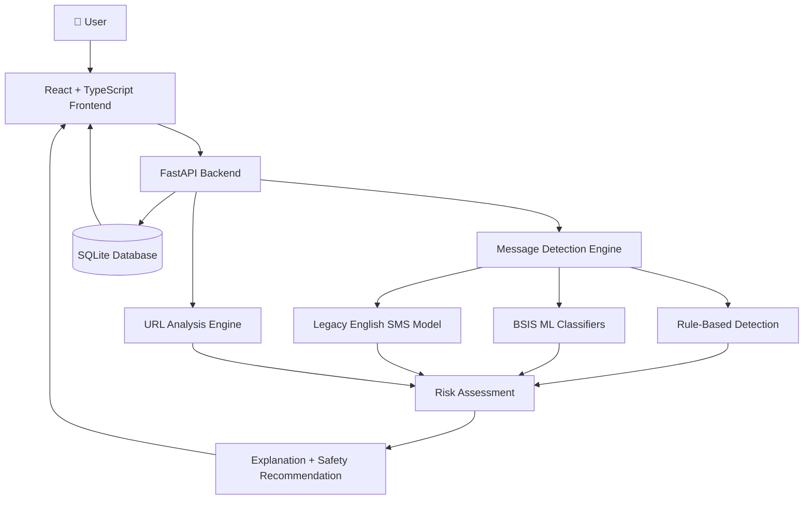

<div align="center">

# 🛡️ CyberSahay

### AI-Powered Multilingual Cyber-Fraud Awareness Platform

---

**Understand suspicious messages. Identify fraud signals. Stay safer online.**


**Created and Developed by Tilak Moger**

</div>

---

## 🌐 About CyberSahay

CyberSahay is an AI-assisted cyber-fraud awareness platform designed to help people identify suspicious digital messages, conversations, and website links.

With the increasing number of online scams, phishing messages, fake KYC notifications, fraudulent reward offers, and OTP-related attacks, people need simple tools that help them understand potential warning signs before taking action.

CyberSahay combines machine-learning models and rule-based detection to examine submitted content, identify suspicious patterns, and provide understandable explanations with safety recommendations.

The platform provides an interface in **English, Kannada, and Hindi**, making cyber-safety awareness more accessible.

> **Our goal:** Make cybersecurity awareness easier to understand and accessible to more people.

---

## 🚀 What Can CyberSahay Do?

| Feature | Description |
|---|---|
| 📩 SMS Analysis | Examine suspicious SMS messages for potential fraud indicators. |
| 💬 Conversation Analysis | Analyze a complete conversation for suspicious patterns. |
| 🔗 URL Analysis | Examine URLs using local security heuristics. |
| 🧠 AI-Based Detection | Use trained machine-learning classifiers alongside detection rules. |
| ⚠️ Risk Assessment | Display Lower Risk, Needs Caution, or High Risk results. |
| 🔍 Explainable Results | Show the warning signals identified during analysis. |
| 🌍 Multilingual Interface | Use the application in English, Kannada, or Hindi. |
| 📊 Analysis History | View recent analysis results through the dashboard. |

---

## 🏗️ System Architecture

CyberSahay follows a frontend-backend architecture.



### How the system works

1. A user submits a message, conversation, or URL.
2. The frontend sends the input to the FastAPI backend.
3. The backend selects the appropriate detection pipeline.
4. Machine-learning models and configured rules examine the input.
5. CyberSahay calculates a risk indicator.
6. The application displays the result, explanation, and recommendation.
7. Analysis metadata is stored in SQLite for recent-history display.

---

## 🧠 How CyberSahay Works

CyberSahay uses multiple detection components.

### 1. Rule-Based Detection

The detection engine searches for suspicious patterns, including:

- Requests to share OTPs.
- Urgent account-verification requests.
- Suspicious KYC update requests.
- Account-blocking threats combined with requests for sensitive details.
- Unexpected prize or reward claims.
- Requests for processing fees.
- Messages containing web links.

These rules provide understandable warning signals.

### 2. BSIS Machine-Learning Models

CyberSahay uses separate trained classifiers for:

- Single-message analysis.
- Conversation analysis.

The selected model depends on the input mode. The classifier output is compared against its configured threshold to determine its prediction signal.

### 3. Legacy English SMS Model

An additional English SMS classifier provides an independent signal for eligible single-message inputs.

The legacy model is skipped for Kannada and Devanagari-script messages.

### 4. URL Analysis

The URL engine examines characteristics such as:

- HTTP instead of HTTPS.
- Unusual hostname formats.
- Raw IP-address hostnames.
- Unusually long hostnames.
- Multiple hyphens.
- Potentially misleading `@` syntax.
- Sensitive-account keywords in hostnames.

**Important:** URL analysis is based on local heuristics. CyberSahay does not currently fetch, crawl, or open submitted URLs.

### 5. Risk Assessment

The final message risk score is derived from the maximum of the rule-based score, BSIS-derived score, and legacy-model-derived score.

| Risk Score | Category |
|---|---|
| 0–29 | 🟢 Lower Risk |
| 30–64 | 🟠 Needs Caution |
| 65–95 | 🔴 High Risk |

Risk scores are heuristic indicators, not calibrated probabilities of fraud.

---

## 🌍 Multilingual Interface

CyberSahay provides an interface in three languages:

- 🇬🇧 English
- 🇮🇳 ಕನ್ನಡ (Kannada)
- 🇮🇳 हिन्दी (Hindi)

The multilingual interface is intended to make cyber-safety information easier to understand.

Interface translation support should not be confused with equal machine-learning accuracy across all languages. Multilingual model performance requires further independent evaluation.

---

## 🛠️ Technology Stack

### Frontend

- React
- TypeScript
- Vite
- CSS
- Tailwind CSS

### Backend

- Python
- FastAPI
- Pydantic
- Uvicorn

### Machine Learning

- Scikit-learn
- TF-IDF
- Logistic Regression
- Joblib

### Database

- SQLite

### Testing

- Pytest
- HTTPX

---

## 📂 Project Structure

```text
CyberSahay/
├── backend/
│   ├── app/
│   │   ├── main.py
│   │   ├── detector.py
│   │   ├── schemas.py
│   │   ├── database.py
│   │   └── config.py
│   └── requirements.txt
├── frontend/
│   ├── src/
│   ├── package.json
│   └── index.html
├── ml/
│   ├── models/
│   ├── training scripts
│   └── evaluation scripts
├── datasets/
├── scripts/
├── tests/
│   ├── test_api.py
│   └── test_detector.py
├── docs/
├── .env.example
├── .gitignore
└── README.md
```

---

## ⚙️ Installation and Setup

### Prerequisites

Make sure the following are installed:

- Python 3.12
- Node.js 20 or newer
- npm
- Git
- Visual Studio Code (recommended)

### Step 1: Clone the repository

```bash
git clone YOUR_GITHUB_REPOSITORY_URL
cd CyberSahay
```

Replace `YOUR_GITHUB_REPOSITORY_URL` with the repository URL after publishing the project.

### Step 2: Set up the backend

Open a terminal in the project root:

```powershell
cd backend
py -3.12 -m venv .venv
.\.venv\Scripts\Activate.ps1
python -m pip install --upgrade pip
python -m pip install -r requirements.txt
```

Start the backend:

```powershell
python -m uvicorn app.main:app --reload
```

Backend address: `http://127.0.0.1:8000`

API documentation: `http://127.0.0.1:8000/docs`

### Step 3: Set up the frontend

Open a second terminal in the project root:

```powershell
cd frontend
npm install
npm run dev
```

Open the frontend at `http://localhost:5173`.

### Step 4: Run automated tests

From the project root, with the backend virtual environment activated:

```powershell
python -m pytest .\tests -v
```

### Step 5: Build the frontend

From the frontend directory:

```powershell
npm run build
```

---

## 🔌 API Endpoints

CyberSahay provides the following REST API endpoints:

| Method | Endpoint | Purpose |
|---|---|---|
| GET | `/api/health` | Check backend status. |
| POST | `/api/analyze` | Analyze messages and conversations. |
| POST | `/api/analyze-url` | Analyze submitted URLs. |
| GET | `/api/history` | Retrieve recent analysis history. |

Interactive API testing is available through FastAPI Swagger UI at `http://127.0.0.1:8000/docs`.

---

## 🧪 Testing and Evaluation

The project includes automated backend API and detection-engine tests.

**Previously verified regression result: 30/30 tests passed.**

Test coverage includes:

- API health and analysis endpoints.
- Message validation.
- URL validation.
- Legitimate message handling.
- Suspicious message detection.
- OTP and KYC-related warning signals.
- Kannada and Hindi script handling.
- Malformed URL handling.
- Unexpected server-error handling.
- False-positive control test cases.

Additional prototype checks included database integrity, CORS behavior, security headers, and frontend production builds.

These results demonstrate prototype functionality, not production-grade fraud-detection effectiveness.

---

## 🔐 Security and Privacy

CyberSahay incorporates several basic security controls:

- Input validation using Pydantic.
- Configurable CORS origins.
- Generic unexpected-error responses.
- Security response headers.
- Parameterized SQLite queries.
- Analysis-history storage without the original submitted message or URL.

### Current limitations

- Authentication is not implemented.
- Rate limiting is not implemented.
- The history endpoint is not protected by authentication.
- No live threat-intelligence integration is included.
- URL checks are not equivalent to live malware scanning.
- Model outputs are not calibrated fraud probabilities.
- Multilingual model performance needs further validation.

CyberSahay should remain a local or controlled research prototype until appropriate production security controls are implemented.

---

## 🔮 Future Improvements

Potential future development includes:

- Improving Kannada and Hindi fraud-detection datasets.
- Better handling of romanized and code-mixed messages.
- More comprehensive false-positive evaluation.
- Model confidence calibration.
- Live URL reputation integration.
- Authentication and role-based access control.
- Rate limiting and abuse prevention.
- Community-driven fraud reporting.
- Deployment monitoring and security hardening.

---

## ⚠️ Disclaimer

CyberSahay is an academic learning and research prototype intended for cyber-fraud awareness.

A lower-risk result does not guarantee that a message or URL is safe. A high-risk result is an indicator that requires independent verification.

Never share OTPs, passwords, UPI PINs, or banking credentials. Verify unexpected requests through official applications, websites, or phone numbers.

Do not open suspicious URLs simply to test them.

---

## 👨‍💻 Author

<div align="center">

### Tilak Moger

**Cybersecurity | Artificial Intelligence | Machine Learning | Software Development**

CyberSahay was developed as a project exploring the application of AI and cybersecurity techniques to multilingual cyber-fraud awareness.

</div>

---

<div align="center">

**CyberSahay — Making Digital Safety Easier to Understand.** 🛡️

</div>
